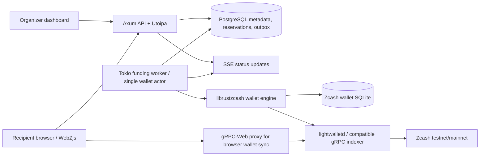

# Z-Split — Rust Backend Architecture & Implementation Stages

**Status:** implementation specification, not an implemented or tested backend.  
**Product source:** `z-split-project-info.md`.  
**Architecture decision:** implement a reservation-first, fund-on-redemption mode as the reliable MVP. Keep the original pre-funded ephemeral-key links as an optional second mode after the security and UX issues below are understood.

## 1. Product contract and security invariants

Z-Split lets an organizer deposit shielded ZEC, mint N one-time claim QR links for set amounts, and distribute the links without asking recipients for their personal wallet addresses. On redemption the recipient's browser creates a fresh ephemeral Zcash shielded wallet, sends **only that ephemeral receiving address** to the coordinator, receives funding, and locally sweeps to a personal shielded wallet when desired. The backend never receives the browser-created spending key or the recipient's eventual personal receiving address.

Non-negotiables:

1. Use official Zcash Rust wallet crates from `zcash/librustzcash`; no custom consensus/cryptographic primitives.
2. Never accept, persist, log, or transmit recipient ephemeral spending keys, seed phrases, or personal wallet destinations to the API.
3. Never create identity-to-recipient-address records. Organizers see room amounts, ticket IDs, and statuses, not recipients' wallet destinations.
4. Ephemeral receiving addresses may necessarily pass through the payout worker and be retained inside the native sender wallet's transaction history. Encrypt any queued ephemeral addresses, give them a short retention period, and never pretend the architecture stores *zero* address-like bytes. The guarantee is **no collection of personal recipient wallet addresses**.
5. Only the client does claim-key generation and sweeping. No secret may appear in a URL path, query, Referer, server log, error trace, or analytics event.
6. QR link carries only a 256-bit bearer ticket in `#fragment`; browser JavaScript uses the ticket in a redeem POST. Token is not itself a Zcash spending key.
7. A public claim token authorizes a **single** redemption; use database atomic transitions, unique constraints, and idempotency. A bearer token may be stolen; consider an optional separate PIN/recipient confirmation in a future mode.
8. Verify transactions and confirmations with the Zcash wallet/chain sync; do not mark a payment confirmed merely because a broadcast request returned success.
9. Distinguish a confirmed **payout to the ephemeral wallet** from an eventual **sweep out of that wallet**. Without privacy-invasive viewing data, the backend cannot independently verify the sweep. Reported sweep != verified sweep.
10. Tests run on regtest/testnet first. Do not promise mainnet safety/audit status.

## 2. Selected payment mechanism

### Recommended MVP: fund on redemption

1. Organizer authenticates, creates a room, specifies N amounts or tiers.
2. API returns a per-room shielded deposit address for the coordinator's **custodial** Zcash account and calculates total ZEC + a conservative fee reserve.
3. Organizer deposits ZEC; wallet synchronizer checks actual confirmed funds. Room becomes `ready` after confirmed spendable balance covers room liabilities and fees.
4. API issues N unique bearer tickets, returns them **only once** for client-generated QR codes and export; backend stores only a keyed digest (HMAC-SHA256 with a server secret) of each ticket.
5. Recipient opens `https://app.example/claim/{claim_id}#t={token}`. Browser creates and securely persists a fresh ephemeral key + Orchard-capable address; if safe persistence/recovery isn't available, block funding rather than risk lost funds.
6. Browser POSTs the bearer ticket plus ephemeral receiver (NOT personal wallet destination) to `/api/v1/claims/{id}/redeem` with an idempotency key. This receiver is encrypted while pending and discarded from the app DB as soon as processing permits. Native wallet transaction history may retain it.
7. In one PostgreSQL transaction, `reserved -> funding_queued` wins for only one redeemer, and an outbox job is inserted. HTTP returns `202` with claim/job status.
8. Single-wallet worker takes the job with `FOR UPDATE SKIP LOCKED` or dedicated wallet actor, constructs the shielded transaction through `zcash_client_backend` and `zcash_client_sqlite`, persists tx ID and updates `funding_broadcast`.
9. Chain watcher tracks mined/confirmed status and chain reorganizations; claim becomes `funded_confirmed` only after policy confirmations.
10. Recipient's browser synchronizes its ephemeral account, locally sweeps to the user's own wallet, and optionally emits a **self-reported** sweep completion. Dashboard's authoritative metric is `funded_confirmed`, not `sweep_verified`.
11. Unredeemed tickets expire; their *reservation* is released, while unspent ZEC remains in the coordinator wallet. Withdraw unused funds through an authenticated organizer operation, accounting for fees and in-flight jobs.

**Trust model:** Organizer/coordinator custody exists until redemption funding. Organizer may retain or copy distributed bearer tickets. Shielded Zcash does not make stolen bearer links recoverable. This design protects recipient *personal wallet address privacy*, not against a dishonest organizer or stolen ticket.

### Alternative: original pre-funded ephemeral-key note links

Organizer browser creates a separate ephemeral spending key per claim, funds the ephemeral addresses in a batch, and distributes `#secret` in each claim link. This works conceptually as a bearer note, but:

- The organizer can copy the ephemeral spending key before delivery; recipient-exclusive custody is not guaranteed.
- The coordinator cannot independently learn if the recipient swept the note unless privacy-sensitive viewing data, advanced proofs, or another attestation mechanism is introduced. Plain self-report is not on-chain verification.
- A timer on the website does **not** revoke an on-chain spend key; "expiry and automatic refund" cannot be guaranteed without a separate recovery mechanism/trust assumption.
- Avoid claiming ZIP-321 is a redeemable token: ZIP-321 is a payment *request* URI.

For hackathon reliability, implement **recommended MVP** first. Keep a feature-flagged `prefunded` strategy for experimentation, but do not mix status semantics across strategies.

## 3. System diagram



**Deployment for MVP:** one API process plus one wallet worker process (or both tasks in one binary), PostgreSQL, a private wallet SQLite volume, a Zcash lightwalletd-compatible gRPC upstream. In browser deployments using WebZjs, a gRPC-Web compatible proxy and WebAssembly threading headers may be required. No Kubernetes, Kafka, Redis, or multi-region setup for the first working demo.

## 4. Rust packages and dependencies

**Zcash-native, official first:**
- `zcash_client_backend`: wallet data APIs, sync, input selection, proposal/create transaction, lightwalletd protobuf/tonic client (`lightwalletd-tonic*` features where needed).
- `zcash_client_sqlite`: canonical Zcash wallet state and compact block cache; access writes **only via SDK APIs**.
- `zcash_keys`: Unified Spending Key / Unified Full Viewing Key and address/key operations.
- `zcash_address`: decoding and network validation of Zcash addresses.
- `zcash_protocol`, `zcash_primitives`: network, values, transaction primitives as required by APIs.
- `orchard`: shielded Orchard primitives, preferably through wallet SDK abstractions.
- `zip321`: separate maintained crate for payment *requests* (not claims).
- `zcash_proofs` or supported proving components as required by the pinned SDK example (do not invent a custom prover).

**Services:** `axum`, `tokio`, `utoipa`, `utoipa-swagger-ui`, `serde`, `serde_json`, `sqlx` (Postgres), `uuid`, `time`, `tracing`, `tracing-subscriber`, `tower`, `tower-http`, `tonic`, `thiserror`, `secrecy`, `zeroize`, `rand`, `hmac`, `sha2`, `subtle`, `argon2` (if using password-based organizer auth), `dotenvy`/`config`.

**Tests/quality:** `cargo test`, `cargo fmt --check`, `cargo clippy -- -D warnings`, `cargo audit`, `cargo deny`, `insta`/`proptest` as appropriate, `criterion` and/or `cargo nextest`, `k6` or `oha` for HTTP load.

**Version policy:** derive a **mutually compatible set** from an actual published `librustzcash` example or its workspace Cargo.lock; pin versions in Cargo.lock. Do not mix the latest versions of Zcash crates blindly, and don't use pre-release versions without a documented reason. Verify actual APIs by compiling minimal end-to-end examples. `utoipa` is the correct crate name; not `utopia`.

**References:**
- https://zcash.github.io/librustzcash/rustdoc/latest/zcash_client_backend/
- https://docs.rs/zcash_client_sqlite/latest/zcash_client_sqlite/
- https://docs.rs/zcash_keys/latest/zcash_keys/
- https://docs.rs/zip321/latest/zip321/
- https://zips.z.cash/zip-0321
- https://github.com/ChainSafe/WebZjs
- https://docs.rs/utoipa/latest/utoipa/
- https://docs.rs/utoipa-swagger-ui/latest/utoipa_swagger_ui/

## 5. Repository layout

```text
zsplit-backend/
  Cargo.toml                   # Cargo workspace, locked dependencies
  Cargo.lock
  rust-toolchain.toml
  .env.example
  docker-compose.yml
  Makefile
  README.md
  docs/
    architecture.md
    privacy-and-threat-model.md
    api-contract.md
    sdk-compatibility.md
    adr-001-redemption-model.md
    benchmarks.md
  crates/
    domain/
      src/{lib.rs,amount.rs,room.rs,claim.rs,errors.rs,traits.rs,events.rs}
    store/
      src/{lib.rs,rooms.rs,claims.rs,payout_jobs.rs,ledger.rs,transaction.rs}
    zcash/
      src/{lib.rs,config.rs,wallet.rs,sync.rs,deposit.rs,propose.rs,broadcast.rs,chain.rs,fees.rs}
    claims/
      src/{lib.rs,issuance.rs,token.rs,redeem.rs,state_machine.rs,expiry.rs,privacy.rs}
  apps/
    api/
      src/{main.rs,state.rs,router.rs,error.rs,auth.rs}
      src/routes/{health.rs,rooms.rs,claims.rs,deposits.rs,events.rs,withdrawals.rs}
      src/openapi.rs
    worker/
      src/{main.rs,dispatcher.rs,chain_watcher.rs,reconciler.rs,shutdown.rs}
  migrations/
    0001_init.sql
    0002_payout_jobs.sql
  tests/
    e2e/{room_flow.rs,redemption.rs,restart_recovery.rs,reorg.rs}
    fixtures/
  benches/
    api_bench.rs
  scripts/
    dev.sh
    test.sh
    load.sh
```

## 6. Module contracts

**Domain:** Plain Rust structs/enums with no Axum, SQL, or SDK imports. `RoomId`, `ClaimId`, `Zats(u64)` with checked arithmetic, `Network`, `RoomStatus`, `ClaimStatus`, `PayoutId`, `ErrorCode`, and traits:

```rust
#[async_trait::async_trait]
pub trait ClaimRepository: Send + Sync {
    async fn issue_batch(&self, command: IssueClaims) -> Result<Vec<IssuedClaim>, DomainError>;
    async fn enqueue_redemption(&self, command: RedeemClaim) -> Result<RedemptionResult, DomainError>;
    async fn get_claim(&self, id: ClaimId) -> Result<Claim, DomainError>;
}

#[async_trait::async_trait]
pub trait PayoutEngine: Send + Sync {
    async fn balance(&self, room: RoomId) -> Result<BalanceSnapshot, DomainError>;
    async fn submit_payout(&self, command: FundingCommand) -> Result<FundingResult, DomainError>;
    async fn transaction_status(&self, txid: &str) -> Result<ChainTxStatus, DomainError>;
}
```

These are **interface examples**, not guaranteed drop-in compilable code; define IDs/DTOs centrally in the actual repository before agents implement. `FundingCommand` contains an ephemeral receiver behind a zeroizing secret-sensitive wrapper, but no spending key.

**Store:** `sqlx` transactions, optimistic versioning, unique token digests, SQL-enforced idempotency, room balance reservation, outbox jobs, worker leases and retries. Never use the application database as a substitute for Zcash wallet state.

**Zcash:** Own a single sender wallet sync/SQLite writer, derive per-room deposit addresses, observe deposits, estimate ZIP-317 fees, build transactions via `propose_transfer` / `create_proposed_transactions` (subject to pinned signatures), retrieve serialized transactions, send through a lightwalletd-compatible service, and track confirmations/reorgs. Isolate CPU-bound proving from Tokio I/O threads via a bounded `spawn_blocking` or a dedicated worker thread/pool. Serialize sender wallet spend operations to avoid double-selecting shielded notes. Wallet state recovery after restart is mandatory.

**Claims:** cryptographically random 32-byte tickets, HMAC digest at rest, in-memory-only raw ticket for issue response; redemption policy; state machine; expiration; optional PIN, encrypted ephemeral receiver during outstanding job; low-information error responses to avoid token enumeration.

**API:** auth and role checks, request body limits, request IDs, CORS explicit allowlist, rate limits, structured JSON errors, Utoipa OpenAPI schemas/paths, `/docs` in dev only, SSE for room summary status (owner-authenticated). No high-risk operations in `GET`.

**Worker:** leader/lease model, bounded concurrency, exponential backoff with jitter, idempotent recovery, chain-watcher that reconciles real transaction state, and a dead-letter/manual-review state for ambiguous broadcast outcomes.

## 7. HTTP contract (v1)

All JSON amounts are **integer zatoshis**; never floating point ZEC. All network-sensitive operations include/validate `network`.

| Method | Path | Auth | Purpose |
|---|---|---|---|
| GET | `/healthz` | public | liveness |
| GET | `/readyz` | public/internal | dependency readiness; no secrets |
| GET | `/api/v1/meta` | public | supported network, confirmation policy, limits |
| POST | `/api/v1/rooms` | organizer | create room and payout amounts |
| GET | `/api/v1/rooms/{room_id}` | owner | room details/status |
| GET | `/api/v1/rooms/{room_id}/deposit` | owner | shielded pool deposit address and balance |
| POST | `/api/v1/rooms/{room_id}/claims` | owner | batch issue QR bearer tickets; return tickets once |
| GET | `/api/v1/rooms/{room_id}/summary` | owner | counts, confirmed funds, reserved, processing, expired |
| GET | `/api/v1/rooms/{room_id}/events` | owner | SSE status updates; no sensitive payloads |
| POST | `/api/v1/rooms/{room_id}/withdrawals` | owner | request withdrawal of **unreserved** funds |
| GET | `/api/v1/claims/{claim_id}` | claim ticket | amount, public state and network; rate limited |
| POST | `/api/v1/claims/{claim_id}/redeem` | claim ticket | atomic redeem, ephemeral receiver, idempotency key |
| GET | `/api/v1/claims/{claim_id}/status` | claim ticket | queue/tx confirmation status |
| POST | `/api/v1/claims/{claim_id}/sweep-report` | claim ticket | optional **unverified** client report |

**Example redeem body** (claim ticket sent in a redacted `Authorization` header, not GET query or URL):

```json
{
  "ephemeral_receiver": "<validated Orchard-capable Zcash unified address>",
  "idempotency_key": "6c87fb7c-c78a-4b86-8e13-52c98aad4b63",
  "client_network": "testnet"
}
```

**Redeem response:** HTTP 202 `{ "claim_id": "...", "status": "funding_queued", "poll_after_ms": 2000 }`. Subsequent calls with the *same* idempotency key return the exact recorded operation; competing token usages must not create additional payouts. For any mismatch return a non-revealing conflict.

**Errors:** stable `{code,message,request_id}` using 400 validation, 401/403 auth, 404 undisclosed invalid claims, 409 duplicate/state conflict, 422 network/amount incompatibility, 429 rate limit, 503 wallet unavailable. Never echo a raw token, address, or seed into an error.

## 8. PostgreSQL model and invariants

Minimal tables:

- `organizers(id, auth_subject, created_at)` — no recipients.
- `rooms(id, organizer_id, network, state, deposit_address, fee_reserve_zat, created_at, expires_at)`.
- `claims(id, room_id, amount_zat, token_digest BYTEA UNIQUE, state, expires_at, payout_id NULL, issued_at, version)`.
- `payout_jobs(id, claim_id UNIQUE, status, idempotency_key, encrypted_ephemeral_receiver, txid NULL, attempts, next_attempt_at, lease_until, error_code NULL, created_at)`.
- `wallet_deposits(id, room_id, txid, amount_zat, block_height, confirmations, state)`.
- `wallet_transactions(txid PRIMARY KEY, payout_id, network, block_height NULL, confirmations, state)`.
- `ledger_entries(id, room_id, claim_id NULL, kind, amount_zat, created_at)` — immutable, balances derived or transactionally materialized.
- `audit_events(id, room_id, event_type, claim_id NULL, actor_type, created_at)` — metadata only, no raw tokens or addresses.

State and SQL constraints: immutable claim amounts after issue, non-negative available room balance, `UNIQUE(payout_jobs.claim_id)`, status check constraints, and room ownership verified on all organizer endpoints. A claim must have exactly zero or one payout. Room `reserved_total + pending_fee_budget` must not exceed confirmed available funding. A payout must not be considered free for reuse until the chain state is definitively reconciled.

Transaction pattern for redeem:

```sql
BEGIN;
SELECT id, room_id, state, expires_at FROM claims WHERE id = $1 FOR UPDATE;
-- Validate ticket digest, expiration, network, room readiness, and fee reserve.
-- If existing matching idempotent result, return it; otherwise disallow second redeem.
UPDATE claims SET state = 'funding_queued', version = version + 1 WHERE id = $1;
INSERT INTO payout_jobs(id, claim_id, status, idempotency_key, encrypted_ephemeral_receiver, ...)
VALUES ($2, $1, 'queued', $3, $4, ...);
INSERT INTO ledger_entries(...);  -- explicit reservation / transition bookkeeping
COMMIT;
```

Do **not** hold SQL transactions during proof construction, network calls, wallet sync, or hardware-limited proving.

## 9. Claim status machine

```text
issued/reserved
  | redeem atomic win
  v
funding_queued -> preparing -> funding_broadcast -> funded_unconfirmed -> funded_confirmed
  |               |                 |                    |
  |               +-- retryable ----+                    +--> reorged -> reconciling
  |
  +--> cancelled (only before broadcast, if policy permits)
  +--> expired  (only if never redeemed)

funded_confirmed -- optional user attest --> swept_reported (not verified)
ambiguous_broadcast -- reconcile wallet/chain, NEVER blindly rebuild and re-send
```

Use distinct flags/columns or event streams for sweep reporting; do not let an unverified client report overwrite the financially authoritative funded status. A queued/broadcast claim is *not* available for expiration refunds. Reorgs must downgrade confirmation-sensitive status and reconcile safely.

## 10. Wallet and funding implementation sequence

1. Validate network and Zcash upstream `get_lightd_info` equivalent; do not accept a mainnet/testnet mismatch.
2. Initialize sender's native wallet database and block cache via `zcash_client_sqlite` SDK APIs; never mutate native tables using raw SQL.
3. Import/create sender coordinator account, with seed stored outside repo/DB in protected secret volume or managed secret store; no seed in logs. Recovery and backup are required.
4. Set wallet birthday and sync compact blocks/subtree roots, including handling reorganizations.
5. Derive an organizer-room deposit receiver and confirm inbound deposits with wallet sync. Avoid global count-based assumptions; model actual spendable balance and fee reserve.
6. When funding job is leased: validate receiver with `zcash_address`/network, amount in zatoshis, room reservation, and spendable notes; use SDK transaction proposal + standard ZIP-317 fee path; construct proofs on bounded workers; persist tx to SDK wallet DB, serialize and broadcast.
7. Persist tx ID and job state with crash recovery. If broadcast returns timeout/unknown, inspect wallet and chain before retrying. Never create a second transaction simply because the HTTP/gRPC request timed out.
8. Chain watcher confirms included tx at configured depth and handles rollbacks/reorgs.
9. Keep a reserved-withdrawable ledger; verify wallet confirmed balance is consistent with all room obligations before withdrawals.

**Important:** `create_proposed_transactions` creates/stores transactions, but the application is still responsible for retrieving serialized transactions and broadcasting them to the network. Proving needs real proving components; this is not a simple synchronous web-handler operation.

## 11. API/Swagger setup

`axum` owns routing. `utoipa` derives OpenAPI from `#[utoipa::path(...)]` annotated handlers and `#[derive(ToSchema)]` DTOs. `utoipa-swagger-ui` mounts a dev-only `/docs` UI and exposes `/openapi.json`. Keep a checked-in OpenAPI snapshot (`docs/openapi.json`) and test for schema drift. Enforce exact request/response types, no generic `serde_json::Value` for domain routes.

Use `tower-http` layers for request ID, tracing with sensitive-header redaction, CORS allowlist, timeout, body limit, and metrics. Authorize organizer room ownership with an extractor/middleware. Keep `/healthz` cheap and `/readyz` dependency-aware. No secret-containing GET query parameters.

## 12. Privacy, security, and threat model

- **Bearer-link theft:** anyone with a valid token can win the first redemption. Use 256-bit entropy, one-time claim, optional 2nd factor/PIN, discreet QR distribution, explicit on-screen warning.
- **Organizer copies token:** organizer can retain bearer QR tickets; funds remain custodial until redemption. State this as an explicit trust assumption.
- **Ephemeral wallet loss:** fund only after browser confirms local persistence/recovery. Provide encrypted download or a user-controlled backup; clearing storage before sweep risks permanent loss.
- **Claim-token leakage:** fragment rather than query string, token-hash DB, redacted auth header, strict CSP, no third-party analytics on claim pages, no unsafe scripts/extensions, Referrer-Policy `no-referrer`.
- **Sensitive data in logs:** strip `Authorization`, seed, ephemeral receiver, account viewing keys, and transaction memo payloads; capture only correlation IDs and enumerated error codes.
- **Wallet DB privacy:** native sender wallets may store sent-output metadata; encrypt/protect its disk volume and restrict operator access; do not market literal zero-address storage.
- **No recipient tracking:** never request real name/email/address for recipients. Room membership authorization can be ticket-only.
- **Double redemption:** unique claim payout and atomic state update; test with 100 or more racing requests.
- **Funds/fees:** checked arithmetic, room reservation, per-wallet serialized spending, dust checks, exact ZEC/ZAT conversion, ZIP-317 fees, outage protection.
- **Slow wallet work:** dedicated bounded proof workers, backpressure, circuit breakers, and queue-depth metrics.
- **Network privacy:** upstream RPC and client IP can correlate access; document this. Public browser sync may contact a gRPC-Web proxy which has access to metadata.
- **Cash out:** Bitrefill integration is out of MVP. Verify accepted payment methods/API and token/gift-card fulfillment before claiming it is available.
- **Refund:** with fund-on-redemption, release unredeemed budget reservations at ticket expiry; funds remain in coordinator wallet and can be withdrawn. This does not claw back funded notes.

## 13. End-to-end development stages

| Stage | Deliverable | Exit gate |
|---|---|---|
| 0. Protocol feasibility | Rust workspace, Zcash crate compatibility proof, testnet/regtest access, WebZjs recipient proof-of-concept | one test transaction can be signed, broadcast, detected, and swept with no server spending key |
| 1. Skeleton/contracts | domain models, API DTOs, repo traits, network config, Docker Postgres, migrations, OpenAPI, CI | `cargo fmt`, `cargo clippy`, `cargo test` pass; `/healthz`, `/docs` work |
| 2. Wallet engine | sender seed management, wallet SQLite, sync/deposits, fees, chain watcher | testnet coordinator wallet recognizes shielded deposit, builds and broadcasts a payment |
| 3. Rooms and issuance | organizer auth, create room, amount/fee validation, reservations, ticket generation, QR data contract | organizer can create 50 tickets; no identity/address collection or token persistence |
| 4. Redemption | token verification, ephemeral receiver validation, atomic state, outbox and worker | two concurrent redemptions result in exactly one queued payout |
| 5. Chain & client integration | funding tx confirmation, SSE dashboard, WebZjs ephemeral receive/sweep, recovery UX | a recipient scans link, receives shielded ZEC, sweeps, and dashboard shows *funded confirmed* |
| 6. Recovery/security | restart reconcile, ambiguous broadcast, reorgs, expiry, refunds, hardening | simulated crash/reorg/timeout cannot cause loss through double send; audit has no secrets |
| 7. Speed and demo | index/use tuned, queue proof concurrency, tracing, k6/criterion, demo script | 50-ticket setup and actual testnet demo, with measured p50/p95 latency and CPU/memory |
| 8. Optional stretch | gift-card adapter, optional PIN, batched prefunding variant | each is behind a flag and has explicit threat model/tests |

## 14. Test matrix

**Unit:** zatoshis math, min/max values, network receiver decoding, token entropy/digest, expiry races, auth ownership, state-machine transitions, fee reserve calculations.

**Integration:** Postgres uniqueness; concurrent 100x redemption attempts; repeated idempotency keys; worker claims same job under concurrency; outbox transaction atomicity; crash between 'created tx' and 'broadcast'; crash after broadcast before DB update; API restart with active SSE clients.

**Zcash integration:** wallet init/sync, Orchard deposit, sending to a fresh receiving address, transaction serialization/broadcast, insufficient spendable notes, stale chain tip, confirmation count, chain reorg and retry, scanning from birthday height, full sweep via browser or reference client.

**Security:** seed/secret regex log scanner; URLs and CORS; authorization bypass attempts; claim-token guessing/enumeration; SQL injection via validated input; no PII/receiver in responses; run SAST/dependency audit; threat model review.

**Performance:** measure API p50/p95/p99 excluding chain confirmation, proof CPU/RAM per transaction, wallet sync cold/warm duration, 50-ticket issuance, queue throughput, DB pool contention, wallet actor backlog, memory peak, and recovery latency. Do not mistake network confirmation time for request latency. Set explicit target SLOs after measuring the available machine and upstream.

## 15. Integration gates for four agents

- **Agent 1 API + database:** owns `apps/api/**`, `crates/store/**`, `migrations/**`; consumes shared domain contracts.
- **Agent 2 Zcash engine:** owns `crates/zcash/**`, wallet worker implementation in `apps/worker/**` only for chain/proving logic.
- **Agent 3 claims/privacy:** owns `crates/claims/**`, token state machine, and claim-specific tests; proposes domain types, does not overwrite shared types without orchestration approval.
- **Agent 4 integration/security/performance:** owns `tests/**`, `benches/**`, `scripts/**`, CI, Docker, `docs/benchmarks.md`; integrates actual components and fixes cross-module compilation with changes agreed with owners.

Shared `crates/domain/**` is initialized by lead/orchestrator before agent work. Each agent uses a separate worktree/branch. Contracts are fixed first; each PR must compile independently against the pinned Rust/Zcash lockfile, document exact assumptions, and include tests. Agent 4 does not declare readiness until live Zcash end-to-end tests pass and security/privacy invariants are checked.

## 16. MVP completion checklist

- [ ] Official Zcash Rust SDK pinned and compiling with Orchard support.
- [ ] Browser ephemeral-wallet receive-and-sweep demonstrated against selected network.
- [ ] Organizer room, deposit, fee reserve, 50 one-time ticket creation.
- [ ] Recipient personal address/spending key never reaches the backend.
- [ ] Atomic redeem with durable exactly-once **intent** and robust duplicate-broadcast reconciliation.
- [ ] On-chain payout funding confirmed; sweep status correctly labelled self-reported.
- [ ] Expiration releases **unredeemed reservations**, not already funded notes.
- [ ] OpenAPI spec and examples are accurate; deployment reproducible.
- [ ] Restart, chain reorg, rate limit, fraud/copy-token and wallet failures tested.
- [ ] Structured metrics, benchmark evidence, threat model and small demo complete.

